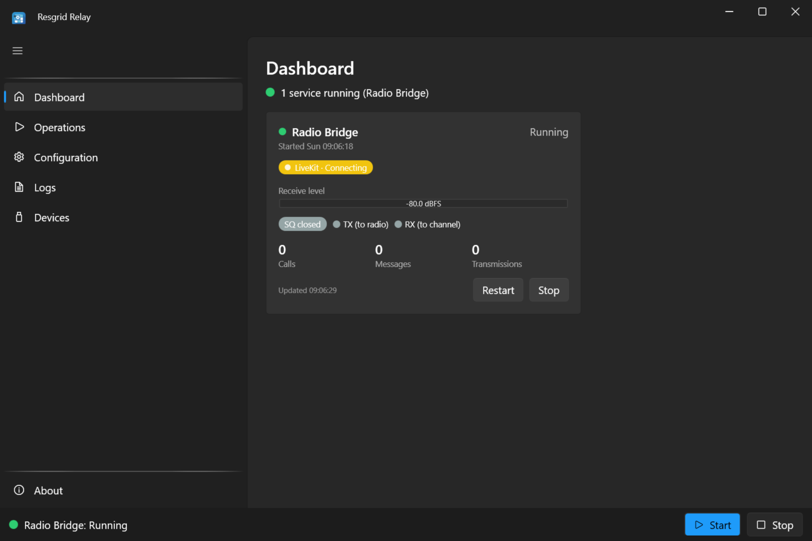
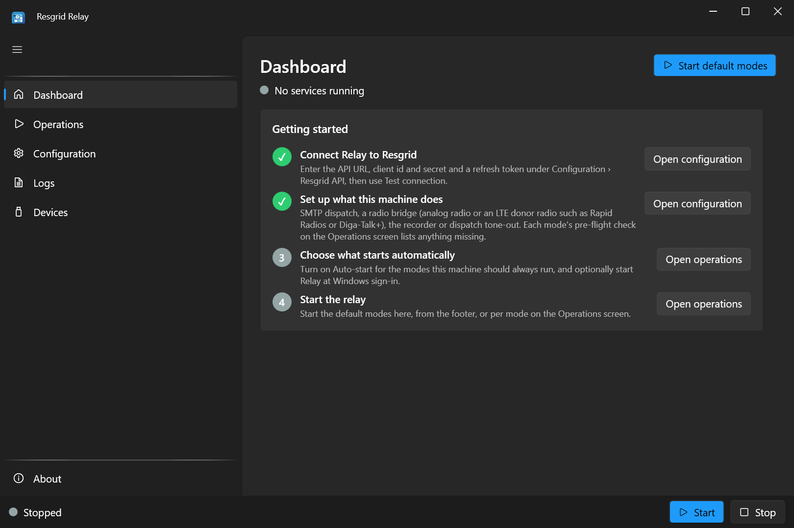
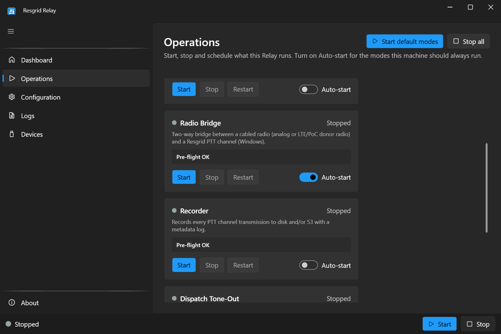
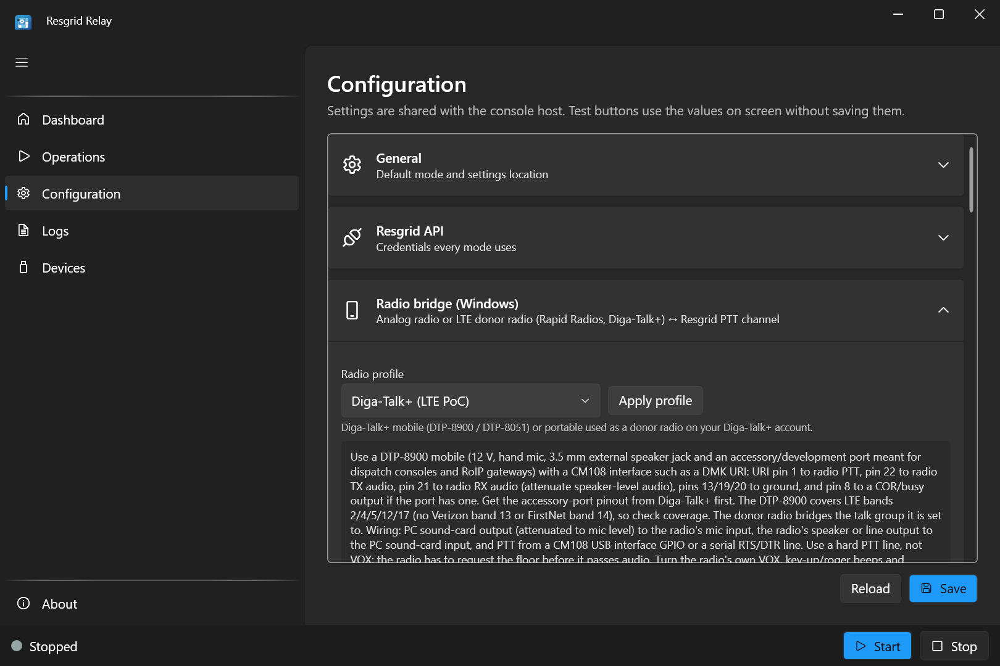
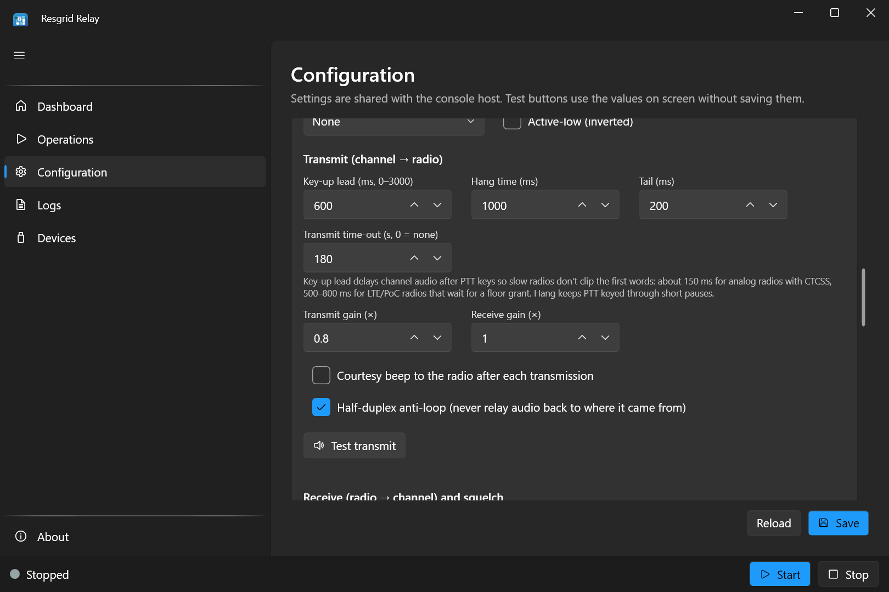
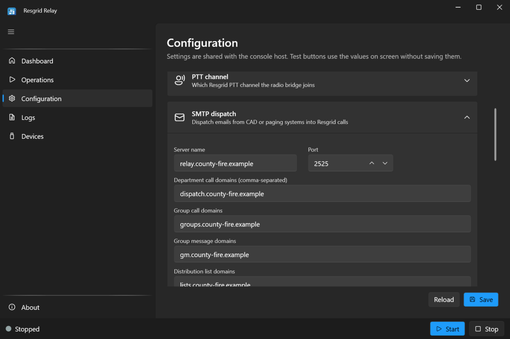
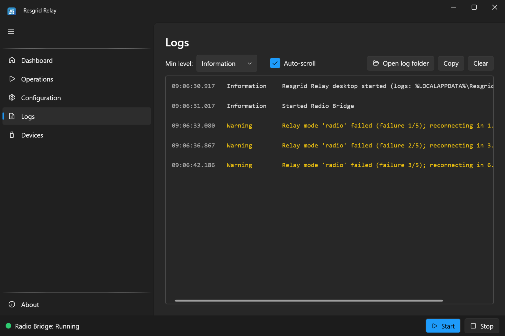

# Resgrid Relay



Resgrid Relay connects the equipment and systems a department already has — CAD and paging email, two-way radios, LTE
push-to-talk radios, scanners and paging tones — to Resgrid, so calls, messages and voice flow between them and the Resgrid
apps. It runs as a Windows desktop app (set up, monitor and manage it with a UI) or headless on Windows, Linux, macOS and
Docker. It talks to a Resgrid department through the **Resgrid v4 API**:

| Mode | Platform | What it does |
| --- | --- | --- |
| `smtp` | any (Linux/Docker) | SMTP server for dispatch email: creates Resgrid calls (and group messages) from inbound mail |
| `audio` | Windows | Listens to a radio/scanner on a sound card for two-tone / single-tone pages and creates a call with the captured audio |
| `radio` | Windows | Bridges a physical radio (sound card + serial/CM108 PTT) to a Resgrid PTT voice channel (LiveKit) |
| `record` | any | Records every transmission on one or all Resgrid PTT channels to disk and/or S3, with a JSONL or SQLite log |
| `dispatch` | any | Tones out new Resgrid calls on a PTT channel: alert tones followed by a spoken (TTS) announcement |

One console process runs one mode (`RESGRID__RELAY__Mode`). The Windows desktop app (`ResgridRelay.exe`) runs several side
by side.

## Features

**Dispatch email into Resgrid (`smtp`)**
- A built-in SMTP server takes dispatch email from CAD, alarm panels, paging gateways or any system that can send mail, and
  creates Resgrid calls (department-wide or per group) or group messages from the address it was sent to
  (`station5@dispatch.your-county.org`).
- Dispatch codes resolve to Resgrid departments and groups (optionally cached in Redis); department codes are validated so
  nobody can page a whole department by guessing an address.
- Attachments (run cards, maps, PDFs) go onto the call; duplicate deliveries are ignored; failures are retried by the
  sender (`451`) instead of lost; one message to several departments pages each of them.
- Hosted mode serves many departments from one relay (`code@departmentId.dispatch.example.org`).

**Radios and Resgrid push-to-talk (`radio`)**
- Two-way bridge between a cabled radio and a Resgrid PTT channel: radio traffic goes to the channel, and Resgrid PTT users
  (Responder, Unit, Dispatch apps) are heard on the radio.
- Works with analog VHF/UHF radios and with **LTE push-to-talk (PoC) donor radios** such as Rapid Radios and Diga-Talk+,
  joining their talk groups to Resgrid PTT. Radio profiles preset the timing and squelch for each kind of radio.
- PTT keying by CM108 USB interface (DMK URI, AIOC, RA-40, RIM-Lite) or serial RTS/DTR; VOX, carrier (COR) and CTCSS
  squelch; key-up lead, hang and tail timing; half-duplex anti-loop; transmit time-out; courtesy tone.
- Live squelch **Tune** meter and **Test transmit** (keys the radio and plays a tone) for setup; emergency-tone detection
  that creates a Resgrid call; optional recording of both sides.
- Recovers on its own from a USB interface being unplugged or a dropped connection.

**Recording (`record`)** — every transmission on one or all PTT channels saved as WAV to disk and/or S3-compatible storage,
with a JSONL or SQLite log (who, channel, start, length), for compliance and after-action review.

**Tone-out (`dispatch`)** — announces each new Resgrid call on a PTT channel: alert tones (two-tone, hi-lo, single) then
the call spoken by Resgrid's text-to-speech, so radio-style crews hear dispatches on their PTT apps.

**Paging tones to calls (`audio`, Windows)** — listens to a scanner or radio on a sound card for two-tone/single-tone pages
and creates a Resgrid call with the recorded dispatch audio attached, per station or department.

**Run and manage it**
- Windows desktop app with a getting-started checklist, a live dashboard per mode, Start/Stop/Restart, auto-start at
  launch, start at Windows sign-in (minimized to the tray), tray notifications when a mode faults, a full settings editor
  with a Resgrid **Test connection**, live logs and device lists.
- Headless console host for Windows, Linux (systemd unit included) and macOS, and a Docker image. The console and desktop
  app share one settings file; environment variables override it for containers.
- Voice modes reconnect automatically; secrets are masked in the UI and never written from environment variables.

## Screenshots

| | |
| --- | --- |
|  |  |
| Getting started checklist | Start, stop and auto-start each mode |
|  |  |
| Radio profiles (analog, Rapid Radios, Diga-Talk+, other LTE radios) | Key-up lead, hang, time-out and Test transmit |
|  |  |
| SMTP dispatch domains | Live logs (also written to rolling files) |

## Download

Each [GitHub release](../../releases) has self-contained builds (no .NET install needed) and `SHA256SUMS`:

| File | Runs on | Modes |
| --- | --- | --- |
| `ResgridRelay-Desktop-<version>-win-x64.zip`, `…-win-arm64.zip` | Windows 10/11 | Desktop app, every mode |
| `ResgridRelay-Console-<version>-win-x64.zip`, `…-win-arm64.zip` | Windows (headless) | every mode |
| `ResgridRelay-Console-<version>-linux-x64.tar.gz`, `…-linux-arm64.tar.gz` | Linux (systemd unit included) | smtp, record, dispatch |
| `ResgridRelay-Console-<version>-osx-x64.tar.gz`, `…-osx-arm64.tar.gz` | macOS | smtp, record, dispatch |
| Docker `resgridllc/resgridrelay:<version>` | Linux containers | smtp, record, dispatch |

Releases are built by [.github/workflows/release.yml](.github/workflows/release.yml) on every merge to `master` (version
`2.1.<run>`), on a `v*` tag, or on demand; [ci.yml](.github/workflows/ci.yml) builds and tests every pull request.

## Solution layout

| Project | Target | Purpose |
| --- | --- | --- |
| `Providers\Resgrid.Providers.ApiClient` | `net10.0` | Resgrid v4 API client (OIDC refresh token, client credentials, system API key) |
| `Resgrid.Relay.Engine` | `net10.0`, `net10.0-windows` | The modes, configuration, resilience and telemetry |
| `Resgrid.Audio.Voice` | `net10.0` | LiveKit voice transport, recording, DSP, tone-out and TTS client |
| `Resgrid.Audio.Core` | `net10.0-windows` | Windows audio capture, tone detection and radio interface (NAudio, PTT) |
| `Resgrid.Audio.Relay.Console` | `net10.0`, `net10.0-windows` | CLI / worker host (Docker, systemd, Windows) |
| `Resgrid.Audio.Relay` | `net10.0-windows` | Windows desktop app |
| `Resgrid.Audio.Tests`, `Resgrid.Audio.Voice.Tests` | | Tests |

## Authentication

Relay talks to Resgrid with one of three grants (`RESGRID__RELAY__Resgrid__GrantType`). Which one a mode can use is decided by
Resgrid's API, not by the relay:

| Grant | How | `smtp` | `audio` | `radio` / `record` / `dispatch` |
| --- | --- | --- | --- | --- |
| `RefreshToken` (default) | A user's OIDC refresh token (`ClientId`, `ClientSecret`, `RefreshToken`) | yes, that user's department | yes | **required** |
| `ClientCredentials` | `client_credentials` grant | yes | yes | no |
| `SystemApiKey` | `X-Resgrid-SystemApiKey` header (hosted, multi-department) | yes, any department | yes | no |

- The voice modes need a **user** token: Resgrid's Voice API refuses the system API key, and a `client_credentials` token has no
  user to join the channel as. They refuse to start with another grant.
- Resgrid **rotates the refresh token on every use**. Relay writes the newest one to `Resgrid:TokenCachePath` (atomically,
  owner-only on Linux) and prefers it over the configured one, so the cache must be on writable, persistent storage. The
  desktop app defaults it to `%LOCALAPPDATA%\Resgrid\Relay\resgrid-token.json`; the systemd unit to `/var/lib/resgrid-relay`.
  Several modes may share one cache file. If you paste in a **new** refresh token, Relay notices and starts from it.
- A refresh token that is not used for longer than its lifetime (2 days unless the client is configured as long-lived in
  Resgrid) expires: keep the relay running, or re-issue the token.
- `ApiVersion` accepts `4` or `v4`.

## Configuration

Settings come from `appsettings.json`, then the per-user `relay.user.json` (`%APPDATA%\Resgrid\Relay` on Windows, written by
the desktop app's Configuration screen), then environment variables prefixed **`RESGRID__RELAY__`** (`__` separates levels).
The console host and the desktop app read the same layers, so a relay set up in the Windows app also runs from the console:

```powershell
$env:RESGRID__RELAY__Mode = "smtp"
$env:RESGRID__RELAY__Resgrid__BaseUrl = "https://api.resgrid.com"
$env:RESGRID__RELAY__Resgrid__ClientId = "YOUR_CLIENT_ID"
$env:RESGRID__RELAY__Resgrid__ClientSecret = "YOUR_CLIENT_SECRET"
$env:RESGRID__RELAY__Resgrid__RefreshToken = "YOUR_REFRESH_TOKEN"
$env:RESGRID__RELAY__Smtp__Port = "2525"
```

`Resgrid.Audio.Relay.Console help` (`.\Resgrid.Audio.Relay.Console.exe help` on Windows) prints the common settings; the
release downloads are self-contained executables. For a framework-dependent build of your own, run
`dotnet Resgrid.Audio.Relay.Console.dll help` instead. A value that can't be read (an empty port, a
misspelled grant type) stops the relay with a configuration error. The main sections:

```json
{
  "Mode": "smtp",
  "Resgrid": {
    "BaseUrl": "https://api.resgrid.com",
    "ApiVersion": "4",
    "ClientId": "", "ClientSecret": "", "RefreshToken": "",
    "GrantType": "RefreshToken",
    "SystemApiKey": "", "DepartmentId": "",
    "TokenCachePath": "./data/resgrid-token.json"
  },
  "Smtp": {
    "Port": 2525,
    "DataDirectory": "./data",
    "DepartmentAddressDomains": [ "dispatch.example.org" ],
    "GroupAddressDomains": [ "groups.example.org" ],
    "GroupMessageAddressDomains": [ "gm.example.org" ],
    "ListAddressDomains": [ "lists.example.org" ],
    "ValidateDepartmentCodes": true,
    "ResolveDispatchCodes": true,
    "DefaultCallPriority": 1,
    "DefaultCallType": "",
    "HostedMode": false, "DefaultDepartmentId": ""
  },
  "Voice": { "Channel": "default", "EnforceSeatLimit": true },
  "DispatchVoice": { "Channel": "default", "PollSeconds": 15, "GiveUpAfterMinutes": 10 },
  "Tts": { "ServiceBaseUrl": "https://tts.example.com", "Voice": "", "Speed": 0 },
  "Recorder": { "Channel": "all", "Store": "local", "LocalPath": "", "Log": "jsonl" },
  "Telemetry": { "Environment": "", "Sentry": { "Dsn": "", "SendDefaultPii": false } }
}
```

A configured domain list replaces the default (`dispatch.resgrid.com`, `groups.resgrid.com`, `gm.resgrid.com`,
`lists.resgrid.com`) for that address type, and a list set in a higher layer (`relay.user.json`, then the environment)
replaces a lower layer's list as a whole rather than merging with it entry by entry. An absent or empty list (`[]`, as in
the shipped `appsettings.json`) keeps the lower layer's list, or the default.

## Desktop app (Windows)

`ResgridRelay.exe` (`Resgrid.Audio.Relay`) sets up, runs and monitors the relay on Windows:

- **Dashboard**: a getting-started checklist, and a live tile per running mode (connection pills, receive level, squelch and
  TX/RX lamps for the radio bridge, call/message/transmission counters, the last fault, Stop/Restart).
- **Operations**: Start/Stop/Restart per mode with a pre-flight check, **Auto-start** per mode, "start at Windows sign-in"
  (minimized to the tray), close-to-tray and fault notifications.
- **Configuration**: every setting, with a Resgrid **Test connection**, device pickers by name, radio profiles, the live
  squelch **Tune** meter and a **Test transmit** that keys the radio and plays a tone. Tests use the values on screen without
  saving them.
- **Logs** (live) and **Devices** (audio, serial and CM108 interfaces). Logs are also written to
  `%LOCALAPPDATA%\Resgrid\Relay\logs` (the newest 14 files; a new file starts each day or at 50 MB).

The tray icon shows each mode's state; closing the window keeps the relay running. For headless or Linux machines use the
console host.

## SMTP mode

Relay is the mail server for your dispatch domains (point their MX at it, or relay to it). It follows the same address rules as
Resgrid's own inbound-email pipeline:

| Recipient | Result |
| --- | --- |
| `code@<DepartmentAddressDomain>` | A call for the **whole department**. `code` must be the department's dispatch email code (checked with `Departments/GetDepartmentByDispatchCode`); any other local part is refused. |
| `code@<GroupAddressDomain>` | A call dispatched to the **group** whose dispatch code is `code` (`Groups/GetGroupByDispatchCode`). |
| `code@<GroupMessageAddressDomain>` | A Resgrid **message** to the group whose message code is `code` (token grants only: the system key cannot send messages). |
| distribution-list addresses | Refused: Resgrid has no API for lists. |

- Routing uses the **envelope** recipients (RCPT TO) as well as To/Cc, so a Bcc'd or forwarded dispatch address works.
- Recipients the relay cannot deliver are refused during the SMTP dialogue (`550`), and a message whose dispatch addresses all
  name nothing Resgrid knows is bounced with `550 5.1.1` so the sending CAD system learns its address is wrong.
- **System API key + department address:** Resgrid never lets the system key page a whole department on its own, so the call is
  saved as a **pending** call (`IsPending`, DispatchList `0`): it waits in the dispatchers' pending queue and pages everyone once
  a dispatcher sends it. Group addresses are dispatched immediately.
- **Hosted mode** (`HostedMode=true`, system key): the department comes from the department dispatch code; a group address also
  needs a department, from `{code}@{departmentId}.{group domain}`, `DefaultDepartmentId`, or a department address on the same
  message. One transaction dispatches one department: a recipient of a different department than the transaction's first
  accepted recipient is deferred with `452 4.5.3`, so the sender delivers it again in a transaction of its own. With
  `DefaultDepartmentId` set, that is the only department the relay dispatches: a recipient of any other department is refused
  with `550 5.1.1` (a retry would not serve it either), and header targets naming another department are dropped.
- Subject becomes the call name, the first line of the body the nature, and the body the note (HTML-only mail is converted to
  text). Attachments are uploaded as call files (`MaxAttachmentBytes`); one Resgrid rejects outright is skipped.
- Duplicates are suppressed by Message-Id, and the call and each attachment carry an `Idempotency-Key`, so a redelivered message
  never creates a second call. A failure that may succeed later is answered `451 4.3.0` (the sender retries; this includes
  authentication failures and a `403` from the code lookups, which an operator can fix); a message Resgrid rejects outright is
  bounced with `554`. That includes a group message to an envelope recipient that Resgrid rejects after the message's call
  was created: the bounce says so, and the call stays.
- Raw messages are kept in `DataDirectory/messages` when `SaveRawMessages` is on, written only once a message has routed,
  and deleted automatically after the longer of `DuplicateWindowHours` and 7 days. They contain dispatch content: protect
  that directory.
- `ValidateDepartmentCodes=false` turns off the department-code check. Only do that for a self-hosted Resgrid that predates
  the endpoint: without it, anyone who can reach the relay can page a whole department.

## Audio mode (Windows)

`settings.json` (`AudioConfigPath`) holds the input device and the watchers:

```json
{
  "InputDevice": 0, "AudioLength": 120, "Multiple": false, "Tolerance": 100, "Threshold": -50,
  "Watchers": [
    { "Name": "Station 1", "Active": true, "Code": "station1code", "Type": 2,
      "Triggers": [ { "Frequency1": 524.0, "Frequency2": 794.0, "Time1": 500, "Time2": 500, "Count": 2 } ] }
  ]
}
```

- `Type = 1`: department (ALLCALL) watcher, pages the whole department. `Type = 2`: group watcher; `Code` is the group's
  dispatch code (resolved to its id), or its id or name. `AdditionalCodes` adds more group codes.
- Fractional tone frequencies (e.g. 368.5 Hz) are matched to the nearest hertz.
- With `Multiple=false`, stations toned while a recording is running ride along on that call.
- The call and the audio upload are retried on transient failures with an idempotency key.
- `GrantType`, `SystemApiKey` and `DepartmentId` come from the host settings, not `settings.json`.

## Radio mode (Windows)

Bridges a radio to a PTT channel: radio receive audio (after the squelch) goes to the channel; channel audio keys the radio.

- Squelch: `Vox` (level, `OpenDbfs`/`CloseDbfs`/`HangMs`), `Carrier` (needs `CarrierDetect=SerialCts|SerialDsr`; without one
  the relay falls back to `Vox`), `Ctcss`, or `Off`.
- Only audible channel audio keys the radio, and one remote talker holds the floor at a time.
- `TxLeadMs` delays channel audio after key-up so radios that are slow to pass mic audio don't clip the first words. Use
  about 150 ms for analog radios with CTCSS and 500–800 ms for push-to-talk-over-cellular (PoC/LTE) radios, which wait for
  the server to grant the floor. The unkey tail grows by the same amount. Default 0; ignored with `PttMethod=Vox`.
- `Radio:Profile` presets (`analog`, `rapidradios`, `digatalkplus`, `poc`) fill in the timing, squelch and signaling values
  for a kind of radio; apply one in the desktop app or with `profiles apply <key>`, then fine-tune. Device and PTT wiring
  settings are never changed by a profile.
- `test-tx` (or **Test transmit** in the desktop app) keys the radio and plays a 2-second 1 kHz tone after the lead, so PTT
  wiring, transmit level and `TxLeadMs` can be checked with a listener on the far side. If the PTT line cannot be released
  it fails (exit code 1) and says so: unplug the interface or turn the radio off.

### LTE / PoC donor radios (Rapid Radios, Diga-Talk+)

Cellular push-to-talk systems such as Rapid Radios and Diga-Talk+ publish no API or radio-over-IP gateway for third-party
audio, so Relay bridges them the way it bridges an analog radio: one of their radios, cabled to the PC, joins the talk group
and Relay bridges it to the Resgrid PTT channel. Resgrid PTT users and the PoC users then hear each other.

- Key it with a hard PTT line (CM108 GPIO or serial RTS/DTR), not VOX: the radio has to win the floor before it passes audio.
- Use `Squelch:Mode=Vox`: a PoC radio's speaker is silent between transmissions, so the audio squelch is clean.
- Turn the donor radio's own VOX, roger/key-up beeps and Bluetooth off, fix its volume, and keep it on external power.
- **Diga-Talk+**: a DTP-8900 mobile (12 V, hand mic, 3.5 mm external speaker jack and an accessory port for consoles and
  RoIP gateways) with a DMK URI or similar CM108 interface. Get the accessory-port pinout from Diga-Talk+ first, and check
  coverage: it uses LTE bands 2/4/5/12/17.
- **Rapid Radios**: a G1 handheld with an AIOC (All-In-One-Cable) on its Kenwood 2-pin jack. The AIOC is a CM108 interface
  (CM108 PTT on GPIO 3, the usual default, or serial DTR); confirm against its firmware notes. It has its own USB ids
  (VID 0x1209, PID 0x7388), not C-Media's: Relay lists it as `[AIOC]` in the desktop CM108 interface picker and the Devices
  screen, and picking it sets `Radio:Cm108VendorId` and `Radio:Cm108ProductId` (the vendor and product id fields can also be
  typed in hex). On the console, `devices` lists it with the values for `relay.user.json` (`4617` and `29576`). The
  Base/Car Unit is not suitable: its RJ45 jack carries mic and PTT but no speaker output.
- The donor radio occupies one radio (and its plan) on the PoC account and bridges whichever talk group it is set to; add
  another radio and interface for each additional talk group.
- `RecordWhileBridging` records both the remote talkers and the radio side.
- Emergency detection: `DetectTones` creates a call (`Emergency:CreateCall`) once per emergency per `CooldownSeconds`.
  **`DetectMdc1200` is experimental**: its decoder does not implement standard MDC-1200 framing, so Motorola emergency bursts
  are not decoded. Do not rely on it.

## Record mode

Joins one channel or `all` and stores each transmission as a WAV (`Store`: `local`, `s3` or `both`) with a metadata row
(`Log`: `jsonl`, `sqlite` or `none`). Each recorded channel occupies a voice seat.

## Dispatch mode

Polls `Calls/GetActiveCalls` every `PollSeconds` and tones out each new call: the `DispatchVoice:Tone` alert followed by the
announcement, spoken in Resgrid's own wording (`New call, {name}. Nature, {nature}. Address, {address}. Priority, {priority}.`,
with the department's priority names and "Second alarm" after an escalation), so the TTS audio Resgrid already generated is
reused from cache. Calls that were open when the relay started are not announced; calls created while it was reconnecting
are. Scheduled calls are announced when they are dispatched. A call whose tone-out keeps failing is retried for
`GiveUpAfterMinutes` (time the LiveKit channel is down does not count, so a call created during an outage is still announced
once the channel is back). `Tts:ServiceBaseUrl` is the Resgrid TTS service.

## Resilience and telemetry

The voice modes reconnect with exponential back-off (`Resilience:*`). After `MaxConsecutiveFailures` they keep retrying every
`MaxBackoffSeconds` and show LiveKit as disconnected (`KeepRetrying`, default `true`); with `KeepRetrying=false` they fault
instead. A configuration error (e.g. the wrong grant) faults immediately. The radio bridge also restarts itself when its audio
device stops (USB unplug), and cuts off a channel talker after `Radio:MaxTransmitSeconds` (default 180, 0 = no limit). Sentry (`Telemetry:Sentry:Dsn`) and Countly (`Telemetry:Countly:*`) are
optional; `SendDefaultPii` defaults to `false`. The local SMTP log includes sender, recipients and subject, never bodies.
Sentry receives addresses, subject, nature and attachment names only with `SendDefaultPii=true`; otherwise it gets domains and
counts. Countly receives domains only.

## Commands

```powershell
dotnet run --project .\Resgrid.Audio.Relay.Console -f net10.0-windows -- run        # run the configured mode
dotnet run --project .\Resgrid.Audio.Relay.Console -f net10.0-windows -- setup      # create the audio-mode watcher file (Windows)
dotnet run --project .\Resgrid.Audio.Relay.Console -f net10.0-windows -- devices    # list audio, serial and CM108 interfaces (C-Media, AIOC) (Windows)
dotnet run --project .\Resgrid.Audio.Relay.Console -f net10.0-windows -- monitor 0  # show input levels for device 0 (Windows)
dotnet run --project .\Resgrid.Audio.Relay.Console -f net10.0-windows -- tune       # live squelch meter for radio mode (Windows)
dotnet run --project .\Resgrid.Audio.Relay.Console -f net10.0-windows -- test-tx    # key the radio and play a test tone (Windows)
dotnet run --project .\Resgrid.Audio.Relay.Console -f net10.0-windows -- profiles   # list radio profiles; 'profiles apply rapidradios'
dotnet run --project .\Resgrid.Audio.Relay.Console -f net10.0 -- version
```

The console targets both `net10.0` (Linux/Docker: smtp, record, dispatch) and `net10.0-windows` (all modes), so `dotnet run`
needs `-f`.

## Docker

```powershell
docker build -t resgrid-relay .
docker run --rm -p 2525:2525 `
  -e RESGRID__RELAY__Mode=smtp `
  -e RESGRID__RELAY__Resgrid__BaseUrl=https://api.resgrid.com `
  -e RESGRID__RELAY__Smtp__DepartmentAddressDomains__0=dispatch.example.org `
  -e RESGRID__RELAY__Resgrid__ClientId=YOUR_CLIENT_ID `
  -e RESGRID__RELAY__Resgrid__ClientSecret=YOUR_CLIENT_SECRET `
  -e RESGRID__RELAY__Resgrid__RefreshToken=YOUR_REFRESH_TOKEN `
  -v relay-data:/app/data `
  resgrid-relay
```

Mount `/app/data` so the rotated refresh token and the duplicate-message store survive restarts. For Linux services see
[deploy/systemd/README.md](deploy/systemd/README.md).

## Build and test

```powershell
dotnet build "Resgrid Audio.sln"
dotnet test "Resgrid Audio.sln"
```

## Authors

- Shawn Jackson
- Jason Jarrett

## License

[Apache 2.0](LICENSE.txt)
